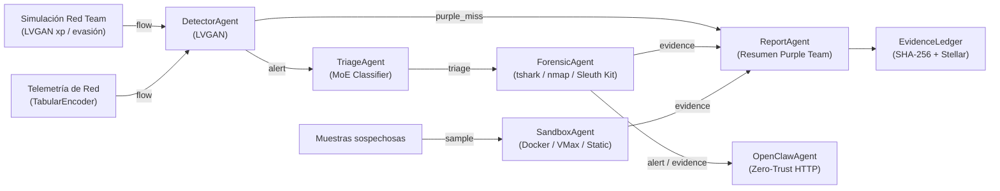

# Studia_IA_Reto — Purple Forensics AI

[](https://github.com/santi8151/Studia_IA_Reto/actions/workflows/ci.yml)
[](https://colab.research.google.com/github/santy8151/Studia_IA_Reto/blob/main/notebooks/Purple_Forensics_AI_Colab.ipynb)

Infraestructura avanzada de ciberseguridad con enfoque **Purple Team** orientada a la detección proactiva de anomalías, simulación adversaria, generación de datos sintéticos con privacidad diferencial, análisis forense automatizado, sandboxing seguro y cadena de custodia verificable.

---

## Arquitectura del sistema



---

## Pilares del proyecto

### 1. Inteligencia Artificial Defensiva y Generativa
- **Latent-Variable GAN (`pfai/models/lvgan.py`)**: arquitectura híbrida Encoder-Decoder + Discriminador operando sobre un espacio latente $z$:
  - **Generación Adversarial ($L_{\text{GAN}}$)**: entrena el decodificador como generador frente al discriminador para producir muestras sintéticas ($x_p$) desde $z_p \sim \mathcal{N}(0, I)$ y poner a prueba las defensas.
  - **Reconstrucción de Línea Base ($L_{\text{Dislike}}$ + MSE)**: reconstruye tráfico benigno ($x \to \tilde{x}$) en espacio de entrada y de características del discriminador ($D_l$) para detectar anomalías mediante `score()` y `score_components()`.
  - **Regularización del Espacio Latente ($L_{\text{prior}}$)**: ajusta $q(z \mid x)$ hacia $\mathcal{N}(0, I)$ para estabilizar las representaciones internas.
  - **Simulación Purple Team**: `generate_evasion_variants()` optimiza perturbaciones latentes para evaluar brechas de detección antes de que ocurran ataques reales.
- **Mixture of Experts (`pfai/models/moe.py`)**: red neuronal con *top-k gating*, pérdida auxiliar de balanceo de carga (Switch-style), soporte para clases desbalanceadas (`class_weights="balanced"`) y análisis de especialización por familia (`benign`, `dos`, `probe`, `bruteforce`, `exfil`) vía `expert_utilization()`.
- **Orquestación Multiagente (`pfai/agents/orchestrator.py`)**: bus asíncrono publish/subscribe con `RedTeamAgent`, `DetectorAgent`, `TriageAgent`, `ForensicAgent` (planificación dinámica filtrada estrictamente por `ALLOWED_TOOLS` y `Scope`), `SandboxAgent`, `OpenClawAgent` y `ReportAgent`.

### 2. Generación de Datos Sintéticos y Privacidad Diferencial (PPML)
- **Codificación Mixta Bidireccional (`pfai/preprocess.py`)**: `TabularEncoder` transforma variables numéricas y categóricas con imputación de nulos y reconstruye tablas (`inverse_transform()`) para auditar muestras generadas.
- **Modelos Tabulares (`pfai/privacy/synth.py`)**:
  - **CTGAN y Gaussian Copula** (compatibles con SDV 1.x y 2.x).
  - **DPTabGAN (DP-SGD con Opacus)**: aplica recorte de gradientes (`max_grad_norm`) y ruido gaussiano calibrado al discriminador con registro formal de presupuesto $(\epsilon, \delta)$ en `PrivacyBudget`.
- **Auditoría Utilidad vs. Riesgo (`pfai/privacy/audit.py`)**:
  - Fidelidad estadística: `ks_mean`, `corr_mae` y `categorical_tv_mean`.
  - Utilidad predictiva: `utility_tstr()` (Train-on-Synthetic, Test-on-Real), `utility_trtr()` (línea base real) y `utility_retention`.
  - Riesgo empírico de fuga: `membership_inference_auc()`, `distance_to_closest_record()` (`DCR` y `NNDR`) y `duplicate_rate()`.

### 3. Herramientas Forenses e Investigación (`pfai/tools/forensics.py`)
- **Wireshark (`tshark`)**: captura en interfaz, conversaciones TCP/UDP (`tshark_conversations_parsed`) y jerarquía de protocolos (`tshark_protocol_hierarchy_parsed`).
- **Nmap**: descubrimiento de servicios (`nmap_service_scan`) restringido obligatoriamente a direcciones IP literales dentro de `Scope` (bloquea hostnames e inyecciones).
- **Autopsy / The Sleuth Kit**: inspección de particiones (`mmls`), listado recursivo y de archivos eliminados (`fls`) y extracción segura por inode (`icat` en `tsk_extract_file`).

### 4. Integraciones y Cadena de Custodia
- **OpenClaw (`pfai/integrations/openclaw.py`)**: cliente HTTP con sesión, reintentos, firma HMAC-SHA256 opcional y sanitización zero-trust (`untrusted_data=True`, nunca ejecuta instrucciones desde respuestas externas).
- **Stellar & Ledger (`pfai/integrity/ledger.py`)**: `EvidenceLedger` JSONL thread-safe encadenado por SHA-256 con `verify_detailed()`, anclaje del hash raíz (32 bytes) en `manage_data` (`anchor_stellar`) y verificación contra Horizon (`verify_stellar_anchor`).

### 5. Entorno de Ejecución Seguro (`pfai/sandbox/sandbox.py`)
- **`DockerSandbox`**: contenedor sin red (`--network none`), sistema de archivos solo lectura, sin capabilities (`--cap-drop ALL`), compatible con `runtime="runsc"` (gVisor) o Kata.
- **`VMaxSandbox`**: flujo estructurado de snapshot limpio -> detonación con red aislada -> recolección de telemetría -> reversión automática en `finally` (configurable vía driver Python, CLI `vmaxctl` o API REST).
- **`StaticFallbackSandbox`**: análisis estático puro (hashes, entropía, magic bytes, URLs, IPs y tokens sospechosos) sin ejecutar la muestra, ideal para Google Colab o CI.

---

## Estructura del repositorio

```text
Studia_IA_Reto/
├── .github/workflows/ci.yml                   # Pipeline CI con pytest
├── notebooks/
│   └── Purple_Forensics_AI_Colab.ipynb        # Notebook listo para Google Colab
└── purple_forensics_ai/
    ├── pyproject.toml                         # Empaquetado e entrypoint `pfai`
    ├── requirements.txt
    ├── pfai/
    │   ├── cli.py                             # CLI unificada (`pfai`)
    │   ├── preprocess.py                      # TabularEncoder bidireccional
    │   ├── data/synthetic_flows.py            # Dataset tabular mixto de flujos
    │   ├── models/{lvgan.py,moe.py}           # LVGAN + MoEClassifier
    │   ├── privacy/{synth.py,audit.py}        # CTGAN, Copula, DPTabGAN + auditoría
    │   ├── agents/orchestrator.py             # Bus y agentes Purple Team
    │   ├── tools/forensics.py                 # Wrappers tshark, nmap y Sleuth Kit
    │   ├── sandbox/sandbox.py                 # Docker, VMax y StaticFallback
    │   ├── integrity/ledger.py                # EvidenceLedger + Stellar
    │   └── integrations/openclaw.py           # OpenClawClient endurecido
    ├── scripts/demo.py                        # Demo end-to-end Purple Team
    └── tests/                                 # Suite de 25 pruebas unitarias e integración
```

---

## Ejecución rápida

### En Google Colab
Haz clic en el botón **Open In Colab** de arriba o ejecuta en la primera celda de tu notebook:

```python
!pip install -q "git+https://github.com/santy8151/Studia_IA_Reto.git#subdirectory=purple_forensics_ai" opacus sdv stellar-sdk matplotlib
```

### En local
```bash
git clone https://github.com/santy8151/Studia_IA_Reto.git
cd Studia_IA_Reto/purple_forensics_ai
python3 -m venv .venv && source .venv/bin/activate
pip install -e ".[all]"

# Pruebas automatizadas
pytest tests -v

# Demo end-to-end y CLI
python scripts/demo.py
pfai capabilities
pfai benchmark-privacy --methods gaussian_copula,dp_tabgan --n-benign 200 --n-attack 50 --epochs 10
```

---

## Límites de seguridad y buenas prácticas
- **Privacidad diferencial**: `CTGAN` y `GaussianCopula` son líneas base estadísticas y **no** proveen garantías $(\epsilon, \delta)$; usa `DPTabGAN` para privacidad diferencial formal y conserva `PrivacyBudget`.
- **Sandboxing**: Docker estándar comparte el kernel del host y no es frontera suficiente para malware real; utiliza gVisor (`runsc`), Kata/Firecracker o `VMaxSandbox` en red aislada.
- **Alcance autorizado**: `nmap_service_scan` exige `Scope` con CIDRs explícitos. Úsalo únicamente en infraestructura propia o con autorización escrita.
- **Stellar**: usa `testnet=True` durante desarrollo; únicamente se publica el hash SHA-256 raíz de 32 bytes (`evidence_root`), nunca logs ni datos sensibles.
